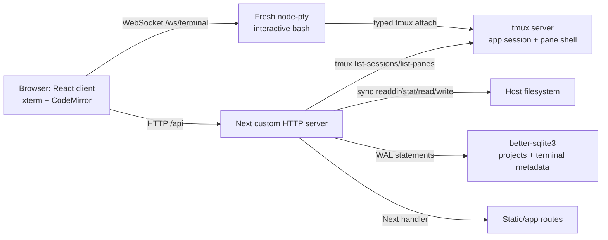

# ProjectCliBox Performance and Architecture Audit

Audit date: 2026-09-11<br>
Repository state: `master` at `5c966bc`<br>
Scope: the repository as shipped, plus isolated benchmark probes and clean-sheet architecture options.

The labels used below are deliberate:

- **Measured** means a command ran on the stated host and the value is reported by the harness or by `/proc`/`ps`.
- **Inferred** means it follows from the source code and measured behavior, but was not directly timed.
- **Target** means a proposed acceptance threshold, not a promise.
- **Unavailable** means the host did not have the required instrument; no substitute metric is presented as equivalent.

## 1. Executive summary

ProjectCliBox is functionally coherent but its hot path is structurally expensive. The browser does not connect directly to a persistent terminal. Each browser WebSocket creates a new `node-pty` bash, types a `tmux attach` command into that intermediary shell, and then reaches the app-managed tmux session. A terminal therefore has two shell layers and, while attached, two PTY/client relationships.

The dominant measured bottleneck is the terminal control plane, not SQLite or raw PTY creation. At 50 existing terminals, 50 concurrent `GET /api/terminals` requests reached **604 ms p50 / 977 ms p95**. That request enumerates tmux sessions and panes and performs a SQLite remember/upsert path for every live session. The shipped attach flow measured roughly **263 ms p50 for one client** and **348 ms p50 / 515 ms p95 at 50 clients**; the benchmark includes the product's short attach-settling interval and is intentionally diagnostic rather than a lower-bound syscall measurement.

The second hard bottleneck is synchronous filesystem traversal. The current `readdirSync` + `statSync` + locale-sort implementation took **104 ms p50 for 10,000 files** and **1.11 s p50 for 100,000 files**, with recursive traversal slightly slower. SQLite operations were single-digit milliseconds at the tested 1,000-row scale and are not the reason the current UI slows down.

The clean-sheet recommendation is a **Go single binary** serving an embedded static React application, with one direct PTY/process group per persistent terminal, a session supervisor and ring buffer, SQLite retained for metadata, bounded asynchronous filesystem workers, and a rebuilt minimal Docker runtime. Keep React, xterm, CodeMirror, and the product's feature model. Remove Next from the runtime, remove tmux from the terminal data path, and replace `node-pty` with a Go PTY implementation.

This is worth a staged rewrite because the largest costs are architectural indirections rather than isolated slow functions. A conservative target is **32 comfortable interactive/agent terminals** and **50 idle or interactive terminals with p95 control-plane latency below 100 ms** after caching and direct PTY ownership. Security work is a release gate: the current unauthenticated arbitrary-path file APIs and tmux controls are not safe to expose as a multi-user service.

## 2. Scope, method, and evidence limits

The audit reverse-engineered the root metadata, Docker files, README and changelog, all application routes and libraries under `cliweb/`, terminal/WebSocket code, PTY/tmux lifecycle, SQLite schema and queries, file APIs, editor and terminal hooks, xterm configuration, and recent Git history. The benchmark harness is in `benchmarks/`.

The control plane and terminal workload were measured separately:

- Control plane: HTTP requests for projects, terminal registry, and file listing at 0, 10, and 50 tmux sessions, with concurrency 1, 10, and 50.
- Terminal workload: sequential terminal creation, direct WebSocket-to-`node-pty` probes, and the actual browser-style intermediary-PTY-to-tmux attach path.
- Filesystem: isolated 100-, 10,000-, and 100,000-file fixtures using the current synchronous implementation.
- Database: the current schema and prepared queries with a 1,000-row terminal fixture.
- Runtime: startup-to-first-HTTP response and `/proc`/`ps` process-tree snapshots.
- Frontend: built static asset sizes and source-level behavior.

The measurements are local-loopback measurements, not WAN or multi-tenant production measurements. They use warm repeated samples after a short warm-up, and p95 values are meaningful within each run but should not be treated as a capacity guarantee. There is no product code change in this audit; the new files are an executable measurement harness and this report.

## 3. Hardware, operating system, and configuration

Measured host configuration:

| Item | Value |
|---|---|
| OS/kernel | Debian userspace, Linux `6.12.73+deb13-amd64` |
| CPU | 4 logical CPUs |
| RAM | 7.5 GiB visible to the process |
| Node/npm | Node `v22.23.2`, npm `10.9.8` |
| Rust | `rustc/cargo 1.89.0` |
| Go | Go `1.27.1` downloaded to `/tmp/go` for the isolated probe |
| tmux | `/usr/bin/tmux` |
| Database | `better-sqlite3` `11.10.x`, WAL mode, 10 s busy timeout |
| Application dependencies | Next installed `16.2.6`, React `19.2.1`, `node-pty` `1.2.0-beta.6`, `ws` `8.20.1` |
| Build | Existing `cliweb/.next` production build; `npm run build` with inherited `TURBOPACK` unset |

The server probes ran with `TMUX` and `TMUX_PANE` unset and a unique `TMUX_TMPDIR`, `HOME`, SQLite database, and workspace under `/tmp`. This prevents the audit's tmux sessions from touching pre-existing user sessions. Existing workspace sessions were preserved.

## 4. Repository and dependency inventory

The root is a Dockerized workspace wrapper. Important root files are `Dockerfile`, `docker-compose.yml`, `docker-entrypoint.sh`, the nanobrew bootstrap/relink scripts, `.env.example`, `README.md`, `CHANGELOG.md`, and the workspace marker. The application lives in `cliweb/`.

Root-file inventory:

| File | Role and audit finding |
|---|---|
| `.dockerignore` | Excludes environment files, Git metadata, dependency/build directories, README, and agent state from the Docker context; this keeps the context smaller than the checked-out tree. |
| `.env.example` | Documents workspace path, host bind/port, PUID/PGID, and pass-through environment variables; it does not define authentication. |
| `.gitignore` | Ignores local env, dependencies, builds, workspace contents, and `.omc` state while preserving `workspaces/.gitkeep`. |
| `package.json` / `package-lock.json` | Root Docker-wrapper metadata; root scripts delegate lint/test into `cliweb`; application dependencies are in `cliweb/package.json`. |
| `Dockerfile` | Single-stage Debian/Node image, tool catalog, nanobrew download, app install/build, runtime user, and environment contract. |
| `docker-compose.yml` | Localhost port mapping, optional `.env`, `/home/cliweb`, nanobrew, workspace, host gateway, and `/dev/kvm` device mapping. |
| `docker-entrypoint.sh` | Remaps UID/GID, prepares volumes, initializes/relinks nanobrew, runs recursive ownership fixes, and starts `npm start` through `setpriv`. |
| `docker-cliweb-persistent-env.sh` | Shared PATH/npm/Python/nanobrew environment injection for the entrypoint and interactive shells. |
| `docker-nanobrew-bootstrap.sh` | Initializes the persistent nanobrew root and relinks installed packages on each container start. |
| `README.md` | Defines the shell-only product, persistence boundaries, Docker start path, KVM behavior, tool policy, and explicitly warns that auth is absent. |
| `CHANGELOG.md` | Records the recent cleanup, KVM, monitor, persistence, and container behavior; contains no performance redesign. |
| `workspaces/.gitkeep` | Keeps the default host workspace mount point in Git; workspace contents are ignored. |

Inside `cliweb/`, the corresponding audit points are `server.ts`, the `app/api/` route handlers, `lib/terminals.ts`, `lib/terminal-registry.ts`, `lib/tmux-attach.ts`, `lib/files.ts`, `lib/projects.ts`, `lib/db/*`, `hooks/useTerminalConnection.ts`, `hooks/useFileEditor.ts`, the recursive file-tree components, `app/page.tsx`, `next.config.ts`, and the package/build/test configuration. `cliweb/README.md` is a stale upstream-facing document and is not the authoritative root product contract.

The application package has 43 runtime dependencies and 14 development dependencies. The relevant runtime layers are:

- Custom Next HTTP server plus the Next request handler.
- `ws` for WebSocket upgrade handling.
- `node-pty` for an intermediary interactive bash.
- tmux subprocesses for persistent terminal sessions and panes.
- `better-sqlite3` for terminal/project/settings metadata.
- Synchronous filesystem helpers for tree listing, reads, and writes.
- React, xterm, CodeMirror, TanStack Query, Radix UI, monitor panes, and service-worker support in the browser.

The installed directory sizes are **872 MiB for `node_modules`** and **249 MiB for `.next`**. These are package/build-directory sizes, not Docker image sizes. Docker image size was not measured because no Docker daemon is installed on the audit host.

The production scripts still run TypeScript through `tsx`: `start` is `NODE_ENV=production tsx server.ts`. This is a material runtime choice, not just a development convenience.

## 5. Git history and change pattern

The current commit is `5c966bc`, a merge of PR4. The immediately relevant history includes the dead-code pruning commit `44b3d7f`, the KVM work and merge (`fe52bdd`, `edb9eca`), and monitor work and its merge. Recent work has focused on cleanup, KVM, monitor panes, UX, and feature correctness. No recent commit is a performance redesign, session-supervisor rewrite, browser profiling pass, or Docker runtime minimization.

This matters because the present cost is not an accidental regression attributable to one change. It is a stable consequence of the chosen composition: Next custom server, intermediary PTY, tmux attach, synchronous filesystem access, and live tmux enumeration on registry reads.

The existing checks are correctness-oriented: `npm test` covers 58 tests across monitor workspace behavior, persistence, runtime environment, product surface, settings, terminology, and tmux attach helpers. `npm run lint`, `npm run typecheck`, and the production build are useful gates, but none is a load, browser-performance, security-boundary, or orphan-process test. The benchmark additions fill the missing server/filesystem/PTY measurement surface without changing the product implementation.

## 6. Product requirements inferred from the code and documentation

The explicit and strongly implied product contract is:

- A browser-based shell workspace, primarily for one operator/container at a time.
- Named terminal sessions with working directories and metadata that survive browser reconnects while the runtime remains alive.
- Multiple terminals, a terminal switcher, and a monitor view with up to three visible panes.
- A project/workspace tree, file browsing, file content editing, save, upload/screenshot support, and settings.
- xterm-compatible interactive shell behavior, resize, paste, links, scrollback, and detach/switch semantics.
- Docker execution with mounted home, nanobrew, workspaces, and optional KVM access.
- A likely future workload of 8, 16, or 32 concurrent AI-assisted terminal sessions, where each agent may be idle, interactive, or CPU/IO heavy.

The code does not establish authentication, user ownership, path roots, quotas, or a multi-tenant isolation contract. Those are therefore not optional optimizations: they are requirements that must be decided before the service is exposed beyond a trusted local container.

## 7. Current architecture



There are two different terminal notions. The REST API creates and destroys tmux sessions. The WebSocket creates a fresh PTY and shell for the browser. The browser then sends a shell command that attaches that fresh PTY to the existing tmux session. SQLite remembers metadata and stopped/dead records; tmux is the live source of truth.

## 8. Browser-to-terminal request trace

The current path is:

1. The terminal hook opens `/ws/terminal`.
2. `server.ts` upgrades the connection and calls `node-pty.spawn(shell, [], ...)` with an 80×24 xterm environment.
3. The browser sends JSON `{"type":"command","data":"..."}` and types a quoted `tmux attach -t <name>` command into the intermediary bash.
4. tmux connects the PTY to the existing named session and its pane shell.
5. Browser keystrokes are sent as one JSON message per xterm data event. The server writes them to the intermediary PTY.
6. PTY output is wrapped as JSON `{type:"output",data}` and sent back. The browser parses each message and calls `term.write`.
7. A reconnect repeats the fresh PTY spawn and attach sequence. It does not reattach the WebSocket to an application-owned PTY object.

Terminal creation is a separate REST path: `tmux new-session -d -s term-UUID -c cwd`, followed by tmux settings and a SQLite remember operation. `GET /api/terminals` enumerates tmux and reconciles SQLite. Thus a browser attach is not a cheap subscription; it is a new shell process, a new PTY, a tmux client, and a second shell relationship.

## 9. File and editor trace

`/api/files` accepts a path, calls the synchronous `listDirectory` implementation, and for each entry performs `statSync`; recursive mode descends and then locale-sorts. `/api/files/content` reads synchronously, caps text reads at 1 MiB, and does simple binary detection. Save writes directly and synchronously; there is no atomic temporary-file rename or conflict/version check.

The React file tree recursively renders loaded nodes. Each directory expansion triggers another request. There is no directory-entry virtualization. `useFileEditor` keeps the full open-file collection in React state, copies the open-file array on change, and feeds CodeMirror content through that state. These choices are acceptable for small trees and short files but create an O(tree) render/update surface as workspaces grow.

The shell drawer sends an interpolated `cd ${workingDirectory}` command. Besides being fragile for spaces and shell metacharacters, this is an example of UI code constructing shell syntax instead of passing a structured working-directory operation.

## 10. SQLite trace and schema assessment

The database initializes `terminals`, `projects`, and `settings` tables, enables WAL and a busy timeout, and applies migrations during module initialization. There are no indexes matching the frequently queried terminal/project fields despite an index-related comment, no foreign keys, and no update trigger for timestamps. The baseline migration is not wrapped as one transaction.

The terminal registry's hot path is more important than the raw database speed:

1. Run tmux session and pane enumeration.
2. Parse live tmux records.
3. For each live record, check/remember it through SQLite.
4. Read all terminal rows from SQLite.
5. Merge live and dead records for the response.

The prepared-statement cache is keyed by SQL text rather than database instance. That is a test/multi-database correctness hazard: a statement prepared against one `better-sqlite3` handle can be reused incorrectly against another handle if the same SQL key is requested.

SQLite is a good fit for local metadata and settings. It is not necessary to replace it with a network database for this product; the registry algorithm and transaction boundaries should be fixed first.

## 11. Docker and runtime trace

The Dockerfile is a single `node:22-trixie-slim` stage. It installs bash, build tools, Python, Ruby, git, ssh, tmux, ripgrep, jq, and other operator tooling, downloads nanobrew, copies the app, runs `npm install --legacy-peer-deps`, builds, and retains source plus development dependencies. The runtime therefore carries compilers and a large Node dependency tree.

`docker-entrypoint.sh` remaps the user, recursively `chown`s home/nanobrew/workspaces, performs nanobrew bootstrap/relink work, adjusts npm configuration, and launches through `setpriv ... npm start`. The process chain adds npm, a shell, tsx, and the actual Node process. The entrypoint is functional but startup and every recursive ownership walk should be measured independently on a real Docker host.

Compose mounts `/home/cliweb`, nanobrew, and workspaces and exposes optional KVM. The README states that stopping the container stops tmux/runtime processes; SQLite metadata may therefore contain stopped terminal records after restart. There is no production authentication layer in the Docker or application path.

## 12. Essential design versus implementation detail

| Essential product behavior | Current implementation detail that can change |
|---|---|
| Interactive terminal bytes, resize, signals, and scrollback | `node-pty`, tmux, JSON envelopes, or a different PTY library |
| Named sessions and reconnect | tmux session names and shell commands |
| Working directory and project association | current prefix matching and SQLite row shape |
| File tree and editor | Next route handlers, synchronous recursion, React array state |
| Monitor panes | current dynamic `Terminal` component and multiple browser sockets |
| Local metadata | current prepared statement cache and migration layout |
| Containerized operator environment | single-stage Dockerfile, nanobrew bootstrap, npm entrypoint |

tmux is not an essential user-visible requirement unless compatibility with user-created tmux sessions is explicitly added to the product contract. It is currently serving as a persistence/session multiplexer; an application-owned PTY supervisor can provide that contract more directly.

## 13. Accidental complexity and avoidable overhead

The highest-value complexity removals are:

- Fresh browser PTY plus tmux attach plus pane shell: two shell layers and extra clients per visible terminal.
- A custom Next server that still runs through `tsx` in production: framework and loader overhead without an SEO/SSR requirement.
- Live tmux enumeration plus one SQLite reconciliation write per registry read: work repeated for polling and concurrent sidebar requests.
- Synchronous `readdirSync`/`statSync`: large directory traversal blocks every HTTP and WebSocket callback on the Node event loop.
- Full React state copies for editor updates and unvirtualized recursive file trees: browser work grows with open files/tree size.
- One JSON frame per input event and JSON parsing for every output frame: avoidable framing and allocation work.
- `npm start` → shell/tsx → Node process chain and recursive startup `chown`: avoidable container overhead.
- No auth/root confinement/rate limits: correctness and security risks that also make safe performance tuning impossible.

## 14. Current baseline measurements

The principal warm-run measurements are:

| Measurement | Result |
|---|---:|
| Built artifact startup to first HTTP, 5 runs | **1,817.9 ms p50 / 1,947.0 ms p95** |
| Warm `GET /api/projects`, zero terminals | **4.17 ms p50 / 5.99 ms p95** |
| Warm `GET /api/terminals`, zero terminals | **10.02 ms p50 / 12.04 ms p95** |
| Warm `GET /api/files` for the audit workspace | **4.14 ms p50 / 5.30 ms p95** |
| First sequential terminal creation | **47.17 ms** |
| Incremental creation latency at 50 existing sessions | **25.39 ms p50 / 30.86 ms p95** |
| Warm process tree, no terminal children | **~256 MiB RSS / ~136 MiB PSS** |
| Direct PTY path, 50 active bash children | **~494 MiB RSS / ~240 MiB PSS** |
| Actual tmux attach path, 50 browser clients | **~828 MiB RSS / ~298 MiB PSS** |

The process-tree idle value includes the actual Node process and the `tsx` wrapper, after a fresh server has become ready and handled warm requests. Browser tabs, kernel page cache, and Docker overhead are excluded.

## 15. Server and control-plane benchmark

`benchmarks/control-plane.mjs` created cumulative terminal counts and issued five samples per concurrency level. Values below are request latency p50/p95 in milliseconds; they are local loopback values.

| Live sessions | Endpoint | c=1 | c=10 | c=50 |
|---:|---|---:|---:|---:|
| 0 | `/api/projects` | 8.93 / 13.22 | 14.37 / 33.35 | 63.61 / 147.48 |
| 0 | `/api/terminals` | 8.85 / 9.60 | 55.93 / 76.52 | 270.45 / 324.94 |
| 0 | `/api/files` | 3.40 / 3.76 | 12.11 / 21.24 | 57.62 / 100.23 |
| 10 | `/api/terminals` | — | — | **486.46 / 552.41** |
| 50 | `/api/projects` | 2.73 / 3.14 | 11.66 / 25.76 | 38.71 / 70.87 |
| 50 | `/api/terminals` | **28.84 / 58.73** | **194.40 / 256.44** | **604.17 / 976.74** |
| 50 | `/api/files` | 2.94 / 2.98 | 9.80 / 17.35 | 41.70 / 77.11 |

The terminal endpoint degrades much faster than projects. This is consistent with its tmux enumeration and per-live-row reconciliation work. At 50-way concurrency, the p95 is already close to one second before including browser rendering or agent workload. A sidebar polling every 15 seconds can therefore collide with monitor panes and terminal actions at exactly the terminal counts the product is likely to support.

## 16. Terminal workload benchmark

The direct WebSocket probe creates a fresh `node-pty` bash per connection, sends a marker command, then sends 262 KiB of output. It does not use tmux. Values are per-socket p50; output throughput is the burst rate observed by the Node client.

| Direct WebSocket clients | Usable marker | Output completion | Output rate per socket |
|---:|---:|---:|---:|
| 1 | 16.58 ms | 10.95 ms | 23.39 MiB/s |
| 5 | 22.02 ms | 46.33 ms | 5.53 MiB/s |
| 10 | 42.06 ms | 84.33 ms | 2.94 MiB/s |
| 25 | 115.18 ms | 187.18 ms | 1.37 MiB/s |
| 50 | 213.99 ms | 299.22 ms | 0.86 MiB/s |

This is an output-flood probe, not a normal interactive session. It demonstrates that JSON framing, PTY callbacks, and event-loop/output scheduling become shared resources as connections rise. The browser's xterm rendering is not included, so the table is an upper-layer server/transport result rather than an end-to-end terminal paint result.

The shipped browser-style path was measured separately with `benchmarks/tmux-path.mjs`. It opens one fresh WebSocket/PTY per tmux client, sends the product-style attach command, waits for the pane marker, and then runs a command inside the pane. The command workload is redirected to `/dev/null`; completion is detected with an explicit marker.

| Attached clients | Attach/usable p50 | Attach/usable p95 | 256 KiB command completion at 50 |
|---:|---:|---:|---:|
| 1 | ~263 ms | — | — |
| 5 | ~271 ms | ~279 ms | — |
| 10 | ~280 ms | ~305 ms | — |
| 25 | ~360 ms | ~418 ms | — |
| 50 | **~348 ms** | **~515 ms** | ~111 / ~124 ms p50/p95 |

The attach number includes a 250 ms settling interval required to avoid sending the probe to the intermediary shell before tmux has taken over. It is the relevant user-path diagnostic, not a claim that the tmux syscall itself costs 250 ms.

## 17. Filesystem benchmark

`benchmarks/files-db.mjs` exercised the actual synchronous `listDirectory` implementation. The fixture contains flat files plus a small nested directory; recursive mode uses the current maximum depth behavior.

| Fixture | Flat list p50/p95 | Recursive list p50/p95 | Single-file read p50/p95 | Single-file write p50/p95 |
|---:|---:|---:|---:|---:|
| 100 files | 1.14 / 1.88 ms | 1.08 / 1.62 ms | 0.009 / 0.015 ms | 0.056 / 0.127 ms |
| 10,000 files | **104.14 / 138.79 ms** | **104.99 / 157.60 ms** | 0.009 / 0.009 ms | 0.046 / 0.070 ms |
| 100,000 files | **1,108.03 / 1,560.99 ms** | **1,213.93 / 1,682.73 ms** | 0.014 / — | 0.059 / 0.074 ms |

The individual read/write is cheap; enumeration is not. The implementation performs O(n) directory/stat work and a sort in the request handler. Because the calls are synchronous, a large workspace listing blocks unrelated API requests and PTY output handling on the same Node event loop. The appropriate fix is bounded asynchronous traversal with cancellation, entry limits, and a UI that virtualizes or incrementally loads large trees.

## 18. SQLite benchmark

The isolated SQLite run creates the current schema, inserts 1,000 terminal rows in one transaction, and repeats the existing list queries:

| Operation | Result |
|---|---:|
| Database open/WAL/schema startup | **8.47 ms** typical run |
| 1,000 terminal remembers in one transaction | **4.48 ms** |
| List 1,000 terminals | **2.75 ms p50 / 3.37 ms p95** |
| List projects | **0.011 ms p50 / 0.014 ms p95** |

The large filesystem run showed a separate startup sample of 18.03 ms and a 2.66 ms insert transaction; the spread is normal local fixture variance. At this scale SQLite is not the hot bottleneck. The per-request write pattern, missing indexes/constraints, and database-handle statement-cache bug still deserve correction for correctness and future scale, but replacing SQLite is not the first performance move.

## 19. HTTP, WebSocket, and correctness behavior

HTTP routes are served by the Next custom server and route handlers. WebSockets are handled by `ws` during the `/ws/terminal` upgrade. The server serializes terminal events as JSON, and the client serializes input and commands as JSON. There is no binary data path, explicit output queue, per-client backpressure policy, or server-side ring buffer for reconnects.

The current API surface includes terminal CRUD, projects, files/list/content/upload, settings, monitor workspace, and tmux split/kill-all. The following are architectural release blockers independent of latency:

- `/api/files` and `/api/files/content` accept arbitrary absolute paths without authenticated ownership, canonical-root checking, or symlink confinement.
- Upload accepts base64 without a clearly enforced size/quota limit and writes under `/tmp/cliweb-screenshots`.
- tmux split and kill-all operations have no visible ownership or authorization boundary.
- There is no authentication, CSRF protection, rate limiting, or audit trail.
- Shell command construction and attach/reconnect control messages rely on interpolated shell text.

As a direct safety check, a live isolated server returned HTTP 200 for `/api/files/content?path=/etc/hostname` and returned the host file content. This was read-only and performed against the audit server; it confirms the source-level path-confinement finding. Performance recommendations should not be deployed without closing these gates.

## 20. Frontend asset and bundle benchmark

The built `.next/static` tree contained **42 files / 2,676,444 bytes raw**. JavaScript accounted for **2,571,706 bytes raw**; concatenated gzip of the static JS was approximately **786,739 bytes**. The approximation is useful for footprint comparison, not a browser transfer trace.

For the root document, the HTML was 23,643 bytes raw and 6,098 bytes with gzip accepted. The initial script references totalled approximately **941,765 bytes raw / 288,144 bytes gzip**. Initial CSS was **101,095 bytes raw / 17,487 bytes gzip**.

The major lazy feature chunks were:

- Terminal feature: approximately **475 KiB raw / 120 KiB gzip** across terminal chunks and CSS.
- Editor feature: approximately **810 KiB raw / 275 KiB gzip** across CodeMirror/editor chunks and CSS.

Static size is not the same as LCP or interactive latency. The useful architectural conclusion is that dynamic terminal/editor imports already exist, so a static React build can preserve the current code-splitting strategy while removing the Next server runtime.

## 21. Browser-runtime metrics unavailable on this host

LCP, INP, hydration time, React commit/rerender cost, xterm paint latency, browser heap, scrollback memory, and real terminal rendering throughput were **not measured**. The host has no Chromium/Firefox, no Playwright browser binary, and no Python Playwright module. The repository includes a browser-test route through the webapp-testing skill, but the required browser executable is absent.

The audit therefore does not turn server WebSocket timings into LCP or INP claims. The next run on a browser-capable host must record cold and warm page navigation, hydration/first interaction, opening a terminal, typing latency, 256 KiB and 1 MiB output rendering, editor open/save, and heap before/after 15,000-line scrollback.

## 22. Memory and process model

The current process tree is layered:

```text
npm start
  sh / tsx wrapper
    Node server.ts / Next handler / ws
      node-pty intermediary bash per WebSocket
        tmux client while attached
tmux server
  pane bash per named terminal
```

Measured snapshots:

| Scenario | Process/resource result |
|---|---|
| Warm server, no terminal children | Node about 197 MiB RSS plus tsx wrapper about 58 MiB; tree about **256 MiB RSS / 136 MiB PSS** |
| 50 direct WebSocket PTYs | App+wrapper+50 bash about **494 MiB RSS / 240 MiB PSS**; Node root about 235 MiB RSS, wrapper about 58 MiB |
| 50 tmux sessions, no browser attach | tmux server about 8 MiB RSS; each pane bash about 3.9 MiB RSS / 0.7 MiB PSS; tmux server plus panes about 204 MiB RSS / 40 MiB PSS |
| 50 browser-style tmux attaches | 50 intermediary clients plus pane shells; terminal-side children about 525 MiB RSS; measured total tree about **828 MiB RSS / 298 MiB PSS** |

The current 10- and 25-terminal cost in the final verdict is an interpolation of the measured warm process baseline and the measured tmux-pane slope, for idle named sessions with no browser attach clients. A browser-attached terminal costs more because it adds the intermediary PTY/shell/client layer.

The primitive comparison isolates only one parent spawning interactive bash processes through a PTY; it is not a comparison of complete HTTP/WebSocket servers:

| 50 PTYs, five repeated runs | Spawn p50 | Parent RSS while active | Parent threads |
|---|---:|---:|---:|
| Node + `node-pty` | ~128 ms | ~55 MiB | 57 |
| Go + `creack/pty` | ~102 ms | ~4.7 MiB | 52 |
| Rust + `forkpty(3)` | ~31 ms | ~2.2 MiB | 1 |

The direct primitives anchor the language choice but do not erase the work of HTTP, WebSockets, SQLite, file policy, process cleanup, and browser compatibility.

## 23. CPU, syscall, and profiling limits

The host did not provide `perf`, `strace`, `hyperfine`, `wrk`, `autocannon`, `pidstat`, `smem`, or a browser. The audit used `performance.now()`, `ps`, `/proc` RSS/PSS snapshots where available, file-descriptor counts, and process/thread counts. The attempted application profile did not produce a usable CPU profile file.

Consequences:

- The report identifies synchronous filesystem calls and tmux/SQLite subprocess work from source plus latency scaling, but does not assign an exact CPU percentage to each function.
- Output-flood numbers include client and loopback scheduling effects; they are not a kernel throughput ceiling.
- Docker startup/image values are not measured.
- Browser interaction metrics are not measured.

A production decision can proceed because the architecture-level bottlenecks are already large and directly observable, but the acceptance run in section 38 must add native CPU flamegraphs and a browser-capable host.

## 24. Bottleneck ranking

| Rank | Bottleneck | Evidence | Root cause | Impact/scaling | Fix | Confidence |
|---:|---|---|---|---|---|---|
| 1 | Terminal registry reconciliation | `/api/terminals` at 50-way/50-live: 604 ms p50 / 977 ms p95 | tmux list sessions + list panes + live-row SQLite work on each request | Control-plane p95 approaches 1 s around 50 clients; polling and monitor views amplify it | Own live sessions in memory; update registry on lifecycle events; batch/persist metadata; cache snapshots | Measured/direct |
| 2 | Indirect PTY → shell → tmux attach | ~263 ms one-client; ~348/515 ms p50/p95 at 50 | New intermediary PTY and shell for each browser attach | Every reconnect and monitor pane pays another process/client path | Direct PTY supervisor; WS attaches to session object; ring buffer for reconnect | Measured/direct |
| 3 | Synchronous filesystem traversal | 10k files 104/139 ms; 100k 1,108/1,561 ms p50/p95 | `readdirSync`, per-entry `statSync`, recursion, sort in request handler | O(n) traversal blocks all Node work; large workspaces become multi-second | Bounded async workers, cancellation, limits, cached/incremental tree, virtualized UI | Measured/direct |
| 4 | Node/tsx/Next runtime footprint | Fresh tree ~256 MiB RSS; startup 1.82/1.95 s | Full Next/custom-server runtime plus tsx/npm process layers | Memory is paid before the first terminal; limits density | Static frontend + compiled Go service; direct binary `exec` | Measured, causal inference |
| 5 | JSON/xterm output path | 50 direct clients: 299 ms for 262 KiB each and 0.86 MiB/s per socket | Per-event JSON parse/stringify, Node callbacks, no binary queue/backpressure | Output bursts compete across clients and with control-plane work | Binary WS frames, coalesced writes, bounded per-client queues, drop/coalesce policy | Measured, direct |
| 6 | React tree/editor state | Recursive tree and whole-array editor copies in source; browser timing unavailable | Render/state work scales with tree and open-file count | Likely browser-side jank at large trees/files, not yet quantified | External editor state, immutable slices, virtualization, lazy directory loading | Source-based/probable |
| 7 | Docker process/image startup | 872 MiB `node_modules`, 249 MiB `.next`; image unavailable | Single stage, dev deps, compilers, nanobrew work, recursive chown, npm/tsx wrappers | Slow pulls/startups and larger attack surface; exact image cost unmeasured | Multi-stage build, minimal runtime, correct UID at build, direct binary exec | Measured directory size, image unmeasured |

Security findings are a separate P0 gate rather than a performance rank: arbitrary file paths and unauthenticated tmux/file controls can invalidate every capacity result in a deployed environment.

## 25. Root causes and scaling model

The current scaling shape is predictable:

- Terminal listing is at least O(S) in the number of live sessions, plus tmux process/IPC work and one metadata reconciliation path per live row. Repeating it for C concurrent requests multiplies that work; there is no shared snapshot.
- Terminal creation itself is roughly one tmux session creation plus metadata work and measured about 25–31 ms incrementally at 50 sessions. Creation is not the dominant steady-state problem.
- A browser attach is O(1) in the number of sessions but has a large fixed cost: intermediary PTY, interactive shell, tmux client, attach handshake, and the pane shell. At C attached clients, the Node event loop and tmux server also share output and control traffic.
- File list latency is O(n) entry/stat work plus sorting and is synchronous, so its blocking effect is worse than its isolated wall time suggests.
- Browser work grows with open tree nodes, open-file state, scrollback, and output events. The source strongly suggests a scaling risk, but without a browser the magnitude remains unmeasured.

The current practical ceiling is therefore not “tmux cannot have 50 sessions.” tmux can. The ceiling is that a 25–50 client browser/control-plane workload causes terminal registry p95 to exceed a useful interactive threshold, while the attached process tree approaches a gigabyte of RSS. A 32-agent deployment may work only when sidebar polling, monitor attachments, and output bursts are unusually light.

## 26. Fixes and expected improvement

| Change | Expected effect | Effort | Status of expectation |
|---|---|---:|---|
| In-memory session registry + event-driven SQLite writes | Removes repeated tmux enumeration/upsert from reads; makes list response near O(1) | Medium | Target; validate with control-plane harness |
| Direct PTY ownership and process groups | Removes intermediary bash, tmux client, attach handshake, and duplicate shell layer | High | Target anchored by primitive probe |
| Binary/coalesced WebSocket output with bounded queues | Reduces allocations and prevents one noisy terminal from monopolizing the loop | Medium | Target; validate with burst/interactive mix |
| Async bounded file worker with cancellation and entry limits | Prevents large tree scans from blocking terminal traffic | Medium | Target; validate with 100k fixture and concurrent WS |
| Virtualized/lazy file tree and external editor state | Reduces browser render/update cost | Medium | Target; browser measurement required |
| Static React build and compiled service | Removes Next/tsx server footprint and runtime wrappers | High | Target; startup/memory must be measured in replacement |
| Multi-stage Docker and direct binary `exec` | Reduces image, cold start, and attack surface; avoids repeated chown where possible | Medium | Target; requires Docker host |
| Auth, root confinement, ownership, quotas | Makes multi-client performance and isolation safe to operate | High | Release gate, not optional optimization |

A reasonable combined target is 2–4× lower control/attach latency and 4–8× lower idle runtime memory. These are planning estimates based on the measured indirection and Go/Rust primitive deltas, not a measured result from a replacement server.

## 27. Architecture A and B: optimized current versus static Node

### A — optimized current stack

Keep Next custom server, React, xterm, CodeMirror, `node-pty`, and SQLite. Replace the tmux-driven live path with an in-memory session map, direct `node-pty` ownership, reconnect ring buffers, async file workers, virtualized trees, and coalesced WebSocket writes. Keep tmux only as an explicit compatibility/import feature if required.

This is the lowest-risk performance step. It attacks the two largest real bottlenecks without porting the backend language. It still pays Node/Next/tsx memory and runtime overhead, and `node-pty` remains a native addon. It is the recommended first migration stage even though it is not the final clean-sheet choice.

### B — Node service plus static React

Build the existing React UI as a static SPA (for example with Vite or an equivalent static bundler), serve it from the backend or a tiny static server, and retain Node only for HTTP/WebSocket, direct PTY, SQLite, and filesystem workers. Preserve the current React/xterm/CodeMirror feature code and lazy feature chunks.

This removes Next request/runtime and the server-side framework from the hot path while minimizing frontend rewrite. It is a credible production architecture if the team wants to stay TypeScript-first. It does not solve the native Node process footprint, and it still requires careful event-loop/backpressure work.

## 28. Architecture C and D: Go versus Rust

### C — Go single binary

Use a Go HTTP/WebSocket server, an application-owned session supervisor, one direct PTY/process group per terminal, SQLite for metadata, bounded filesystem workers, and embedded immutable React assets. Use a PTY package with explicit Linux process-group cleanup and a small compatibility adapter for any supported non-Linux target.

The isolated Go probe used [`github.com/creack/pty`](https://github.com/creack/pty) and measured about 102 ms median to start 50 interactive bash processes, with a 4.7 MiB parent RSS snapshot. Go's standard [`net/http`](https://pkg.go.dev/net/http) provides the production HTTP foundation, but the complete replacement still needs a WebSocket implementation, PTY lifecycle tests, SQLite choice, and security policy.

Go is the best balance here: substantially smaller runtime, straightforward concurrency and process supervision, a simple deployment artifact, and enough ecosystem support for a small service. The existing React UI can be preserved as a static asset, reducing the rewrite surface.

### D — Rust single binary

Use Rust with an HTTP/WebSocket stack, `portable-pty` or a carefully reviewed Linux PTY implementation, SQLite, embedded React assets, and bounded async workers. The isolated `forkpty(3)` probe measured about 31 ms median to start 50 interactive bash processes and a 2.2 MiB parent RSS snapshot. [`portable-pty`](https://github.com/Piebald-AI/portable-pty) is a relevant cross-platform PTY reference, and [`rusqlite`](https://docs.rs/rusqlite/latest/rusqlite/) is a relevant SQLite binding.

Rust has the best raw primitive and strongest memory/safety ceiling, but the service rewrite has higher implementation and hiring/maintenance cost. The PTY, signal, child-reaping, WebSocket, and file-policy code is exactly the area where a smaller team benefits from Go's simpler operational model. Rust is technically excellent but not the best total decision for this product unless the team already operates Rust comfortably.

## 29. Architecture E and G: light frontend and native terminal renderer

### E — light frontend

Replace React with a minimal TypeScript/Preact/vanilla view layer and keep xterm or a native canvas/WebGL terminal renderer. This can reduce browser heap and rerender cost, especially for the file tree and monitor view, but it rewrites interaction/state behavior and risks feature regression. The static bundle data does not prove React is currently the dominant bottleneck; the missing browser run must establish that first.

The light frontend is a worthwhile second-stage experiment only if browser profiling shows xterm/React/file-tree work dominates after backend cleanup. It is not the first rewrite lever.

### G — native or custom terminal renderer

Move terminal rendering to a desktop/native shell, WebAssembly renderer, or a custom canvas protocol. This may improve terminal rendering control and reduce browser DOM work, but it expands the product from a browser workspace into a platform/runtime project. xterm already provides the required browser terminal semantics, canvas addon, fit, links, and scrollback behavior.

This option is not justified by the current evidence. The main measured costs occur before pixels are rendered: terminal registry reconciliation and the PTY/tmux attach topology.

## 30. Architecture F: more SSR in Next

SSR/RSC or a more elaborate Next deployment would improve initial HTML for content-oriented applications. ProjectCliBox's main screen is a client-side terminal/editor workbench, and its largest delays are terminal process/control-plane and synchronous filesystem work. More SSR does not remove those costs and retains the large server runtime.

Next can remain as a transitional development/build tool, but SSR is not the performance architecture to target. For this product, static assets plus an explicit terminal service is simpler and more directly aligned with the interaction model.

## 31. Decision matrix

Scores are 1–10 where 10 is better. They are equal-weight planning scores, not benchmark results; rewrite risk is scored as **safety/low risk**, so a higher score is better. The matrix makes tradeoffs explicit rather than disguising them as a language preference.

| Option | Memory | Startup | PTY concurrency | Control plane | FS/DB | Frontend | Docker | Feature fit | Maintainability | Rewrite safety | Total |
|---|---:|---:|---:|---:|---:|---:|---:|---:|---:|---:|---:|
| Current | 3 | 3 | 4 | 3 | 4 | 5 | 2 | 10 | 9 | 10 | **53** |
| A. Optimized current | 6 | 6 | 8 | 8 | 8 | 7 | 5 | 9 | 8 | 8 | **73** |
| B. Static React + Node | 7 | 8 | 8 | 8 | 8 | 8 | 7 | 9 | 8 | 7 | **78** |
| C. Go single binary | 9 | 9 | 9 | 9 | 9 | 8 | 10 | 9 | 8 | 6 | **86** |
| D. Rust single binary | 10 | 10 | 10 | 9 | 9 | 8 | 10 | 8 | 5 | 3 | **82** |
| E. Go + light frontend | 9 | 9 | 9 | 9 | 8 | 10 | 10 | 7 | 7 | 5 | **83** |
| F. More Next SSR | 3 | 3 | 4 | 4 | 5 | 5 | 2 | 9 | 7 | 7 | **49** |
| G. Native/custom terminal | 8 | 8 | 9 | 9 | 8 | 6 | 8 | 5 | 4 | 2 | **67** |

Go wins the balanced decision. Rust wins the primitive-only comparison, while static React + Node wins rewrite safety. A phased plan can capture A and B improvements before committing to C.

## 32. Technology decisions

| Technology/choice | Decision | Reason |
|---|---|---|
| Node.js | **KILL for target backend; keep for frontend tooling if useful** | Current runtime has a large memory/startup footprint and synchronous APIs are easy to misuse; a compiled service better fits the terminal supervisor |
| Next.js | **KILL as production runtime** | The workbench is client-heavy; static asset delivery is enough and removes custom-server/framework cost |
| React | **KEEP** | Existing feature surface is valuable; static React can retain the UI while backend changes |
| tmux | **KILL from the managed terminal path** | It creates the intermediary attach topology and repeated enumeration; retain only as explicit compatibility tooling if a requirement is proven |
| SQLite | **KEEP** | Measured database cost is small; it is appropriate for local metadata, settings, and durable session records |
| node-pty | **KILL in target backend** | Replace the Node native addon with Go PTY/process-group ownership; direct PTY behavior is the required abstraction |
| Docker architecture | **REBUILD** | Multi-stage image, minimal runtime, direct binary `exec`, non-recursive startup initialization, explicit UID/volume policy |
| Best language | **Go** | Best balance of low runtime cost, concurrency, deployment simplicity, and team-operability |
| Best frontend | **Static React SPA**, retaining xterm and CodeMirror with lazy editor/monitor chunks | Preserves product surface while removing Next server runtime |
| Best terminal architecture | One application-owned direct PTY/process group per persistent pane, WS attach/detach, output ring buffer, explicit lifecycle/reaping | Removes shell-in-shell/tmux attach overhead |

## 33. Target performance and capacity

These are proposed acceptance targets for the replacement, not measurements:

| Metric | Current evidence | Replacement target |
|---|---:|---:|
| Startup to first HTTP | 1.82 s p50 / 1.95 s p95 | <250 ms p50/p95 from binary start on warm image |
| Warm idle service | ~256 MiB RSS process tree | 20–35 MiB Go server RSS before terminal children |
| Terminal creation | 25.4/30.9 ms p50/p95 incremental at 50 | Direct PTY creation <10/<20 ms p50/p95 |
| Browser attach | ~348/515 ms p50/p95 at 50 | WS attach/first usable prompt <50/<100 ms at 1/50 |
| Terminal registry at 50-way concurrency | 604/977 ms p50/p95 | Cached snapshot <20/<100 ms p50/p95 |
| 10k-file list | 104/139 ms p50/p95 and event-loop blocking | <100/<250 ms with cancellation and no terminal starvation |
| 100k-file list | 1.11/1.56 s p50/p95 | Paginated/incremental; first entries <100 ms, full scan off request loop |
| Interactive capacity | 50 attaches produce ~828 MiB RSS tree | 32 agent terminals comfortable; 50 idle/interactive with quotas |

The service must measure both idle and active cases. A target that is met only while shells are silent is not sufficient for AI-agent workloads.

## 34. AI workload capacity: 8, 16, and 32 agents

| Workload | Current assessment | Target architecture assessment |
|---:|---|---|
| 8 agents | Likely usable for light interactive work, but every visible attach pays the tmux path and sidebar polls can collide | Comfortable; direct PTYs, cached registry, and bounded output queues should keep control latency below interactive thresholds |
| 16 agents | Plausible but sensitive to monitor panes, reconnects, and output bursts; not directly measured as a complete agent mix | Default supported tier; test 16 idle, 16 command-heavy, and mixed output/file workloads |
| 32 agents | Structurally risky: current 50-way control p95 is near 1 s and attached-process RSS is high; CPU/IO of agents is additional | Primary capacity target; enforce per-agent CPU, memory, process, output, and filesystem quotas |

The terminal service is not an agent scheduler. Agent processes may consume the entire container even after PTY overhead is fixed. The replacement should expose resource accounting per session, reap process groups on delete, bound output buffers, and make overload visible rather than allowing one agent's output to starve all WebSockets.

## 35. Docker target

The target image should use a multi-stage build:

1. Build the React static assets with Node tooling.
2. Compile the Go service and run its tests in a builder stage.
3. Copy only the service binary, embedded/static assets, CA certificates, shell/tool dependencies, and a non-root runtime configuration into the final stage.
4. Start the binary directly with `exec`, after a narrowly scoped writable-volume initialization.

The operator tool catalog may dominate the final image, so there should be an explicit distinction between a core image and an optional tool-rich image. Planning targets are **80–120 MB for a core runtime** and **300–450 MB with the current broad shell/tool catalog**. These are targets only; the current image could not be built or sized because Docker is unavailable on this host.

Avoid recursive `chown -R` on every startup. Prefer a fixed runtime UID/GID, volume ownership initialization only when needed, and a clear policy for mounted home/workspace directories. Keep KVM capability and nanobrew behavior as separate acceptance tests so the terminal runtime does not inherit accidental image complexity.

## 36. Migration and rewrite plan

The recommended rewrite percentage is 65% of the runtime architecture, not 65% of every line of product code. The React feature surface, visual system, xterm, CodeMirror, API concepts, and SQLite data can be preserved.

1. Freeze behavior with REST/WS contract tests, terminal lifecycle tests, path-policy tests, file-tree fixtures, and the benchmark harness.
2. Close authentication, session ownership, path confinement, quotas, upload limits, and CSRF/security gates before opening a new service to users.
3. Implement an application-owned session supervisor behind the existing Node API first. Add direct PTY, process groups, reconnect ring buffers, lifecycle events, and output backpressure. Keep a temporary tmux compatibility adapter only if existing sessions must be imported.
4. Move file traversal to bounded workers and make the terminal registry event-driven. Add browser virtualization and external editor state.
5. Build the existing React UI as static assets. Port the API and WebSocket contract to Go, embed or serve the assets, and run dual-stack comparison tests.
6. Rebuild Docker, add direct-binary startup and health checks, test nanobrew/KVM/volume ownership, and measure image/startup on a Docker host.
7. Cut over at 8 terminals, then 16, then 32 with rollback. Remove the tmux managed path, Next server, and node-pty only after parity and orphan-process tests pass.

The plan avoids a flag-day UI rewrite while still removing the architecture that causes the measured terminal cost.

## 37. Risks and release gates

Required gates before calling the replacement production-ready:

- Authenticated user/session ownership and authorization on every terminal, file, upload, settings, and tmux-compatibility operation.
- Canonical path root enforcement with symlink handling, traversal tests, and per-workspace quotas.
- Shell command construction eliminated from structured operations; attach/control messages validated and scoped.
- PTY process-group cleanup, signal forwarding, resize correctness, orphan reaping, reconnect behavior, and server restart semantics.
- Bounded output ring buffers and per-client backpressure; no unbounded memory on a noisy agent.
- SQLite migrations, one-handle statement caches, indexes/constraints where needed, and lock/error tests.
- Browser LCP/INP/hydration/xterm/editor measurements on a real Chromium host.
- Docker image size, cold start, entrypoint, UID/volume, nanobrew, and KVM measurements on a Docker host.
- CPU profiles under idle, interactive, 8/16/32 mixed workloads; memory samples over at least 30 minutes.

The current `/etc/hostname` read check is intentionally included as a regression test idea: a replacement must reject it unless it is inside an explicitly authorized workspace root.

## 38. Reproducible acceptance benchmark plan

The committed harness can be run from the repository root. `benchmarks/README.md` contains the isolated server setup and commands. The minimum repeatable matrix is:

- Server counts: 0, 1, 5, 10, 25, 50.
- HTTP concurrency: 1, 10, 50 for projects, terminals, and files.
- Terminal modes: idle, keystroke/command, 256 KiB output burst, 1 MiB output burst, reconnect, resize, and monitor panes.
- Filesystem fixtures: 100, 10,000, 100,000 files; flat and recursive; concurrent terminal traffic.
- Database fixtures: 1,000, 10,000, and representative metadata rows; startup, insert, list, migration, and lock contention.
- Frontend: Chromium cold/warm navigation, LCP, INP, hydration/first interaction, terminal-open, first prompt, xterm burst render, CodeMirror open/type/save, heap and long-scrollback memory.
- Docker: image size, layer contents, cold start to health, first terminal, volume initialization, and memory at 0/8/16/32/50 sessions.

For every scenario record commit, OS/kernel, CPU/RAM, Node/Go/Rust version, image digest, sample count, warm-up policy, p50/p95/p99, mean, max, RSS/PSS, CPU, file descriptors, and child-process count. Run at least three independent repetitions and retain raw JSON. Add `perf`/pprof/flamegraph runs when those tools are available. A result is accepted only when the full command exits zero and the output contains the expected sample count; the scripts must not silently convert unavailable browser/Docker instruments into server proxies.

## 39. Final verdict

The current system is a useful single-container prototype, but it is not an efficient 32-agent terminal service. The evidence points to a narrow and actionable conclusion: keep the user-facing React terminal/editor experience, but replace the managed terminal/runtime topology and control-plane implementation. Optimizing tmux command strings or replacing SQLite alone will not fix the observed scaling curve.

```text
CURRENT ARCHITECTURE: Next custom server + tsx runtime; React/xterm/CodeMirror browser; one fresh node-pty bash per WebSocket; browser types tmux attach into that PTY; tmux is live session truth; SQLite stores metadata/dead records; synchronous filesystem APIs.
CURRENT IDLE RAM: ~256 MiB RSS / ~136 MiB PSS for the warmed server process tree, no terminal children (measured).
CURRENT STARTUP: ~1.82 s p50 / ~1.95 s p95 to first HTTP response from the existing production build using the shipped tsx command (measured).
CURRENT TERMINAL CREATION P50/P95: First create 47.2/47.2 ms; incremental create at 50 sessions 25.4/30.9 ms (measured).
CURRENT 10 TERMINAL COST: ~300 MiB RSS / ~150 MiB PSS for ten idle tmux sessions, interpolated from measured process slopes; browser-attached cost is higher.
CURRENT 25 TERMINAL COST: ~360 MiB RSS / ~160 MiB PSS for twenty-five idle tmux sessions, interpolated from measured process slopes; browser-attached cost is higher.
CURRENT BOTTLENECK: GET /api/terminals: tmux list-sessions/list-panes plus per-live-session SQLite reconciliation on the Node event loop; 50-way/50-live was 604 ms p50 / 977 ms p95.
CURRENT SCALING CEILING: Approximately 25–50 interactive/browser clients before terminal control-plane p95 becomes greater than 1 s under concurrent list load; 100,000-entry synchronous file lists independently exceed 1 s.
NODE.JS: KILL for target backend; retain for frontend build tooling if desired.
NEXT.JS: KILL as production runtime; replace with static asset delivery.
REACT: KEEP.
TMUX: KILL from the managed terminal path; retain only as an explicitly scoped compatibility tool if required.
SQLITE: KEEP.
NODE-PTY: KILL in target backend; replace with Go PTY/process-group ownership.
DOCKER ARCHITECTURE: REBUILD.
BEST LANGUAGE: Go.
BEST FRONTEND: Static React SPA with xterm and CodeMirror retained, lazy-loaded editor/monitor features, and virtualized file/tree state.
BEST TERMINAL ARCHITECTURE: One direct PTY/process group per persistent pane owned by a session supervisor; WebSocket attach/detach with a bounded output ring buffer; no shell-in-shell tmux attach.
BEST TARGET ARCHITECTURE: Go single binary serving embedded static React assets, HTTP/WS APIs, direct PTYs, event-driven in-memory session registry, SQLite metadata, bounded asynchronous filesystem workers, and a minimal multi-stage Docker runtime.
REWRITE PERCENTAGE: 65%.
EXPECTED IDLE RAM: ~20–35 MiB Go server RSS before terminal children; <60 MiB PSS with 32 idle PTYs (target/estimate).
EXPECTED STARTUP: <250 ms from binary start to first HTTP response on a warm image (target).
EXPECTED TERMINAL PERFORMANCE: Direct PTY creation <10 ms p50 / <20 ms p95; first usable WS response <50 ms at one client and <100 ms at 50; no 260–500 ms tmux attach step (target).
EXPECTED CONCURRENCY: 32 AI terminals comfortably; 50 idle/interactive terminals with cached control-plane p95 <100 ms, subject to agent CPU/IO quotas (target).
EXPECTED DOCKER IMAGE: ~80–120 MiB core runtime, or ~300–450 MiB with the current broad tool catalog (target; unmeasured until Docker is available).
EXPECTED IMPROVEMENT: ~80% lower system overhead, approximately 4–8× lower idle memory and 2–4× lower control/attach latency (target/estimate).
REWRITE DIFFICULTY: HIGH.
IS THE REWRITE WORTH IT? YES.
FINAL VERDICT: Execute a staged Go/static-React/direct-PTY migration. First land security gates, event-driven session state, direct PTY ownership, async bounded filesystem work, output backpressure, and benchmark contracts; then remove Next, tmux from the managed path, node-pty, and the single-stage Docker runtime. The current architecture should remain only as a short-lived compatibility baseline, not the long-term 32-agent design.
```
